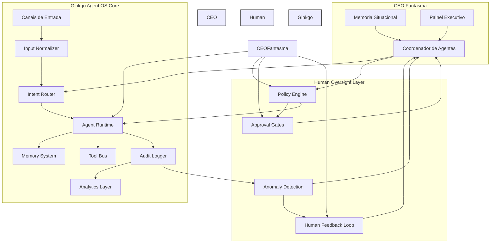

# GINKGO-ARCHITECTURE-REPORT-V2.0.md — Relatório de Arquitetura Final "Sem Lacunas"

> **Versão:** 2.0.0 | **Data:** Abril 2026  
> **Autor:** Manus AI  
> **Status:** Definitivo / Executável  
> **Objetivo:** Apresentar a arquitetura unificada e robusta do ecossistema Ginkgo, consolidando todos os documentos e preenchendo as lacunas identificadas para garantir um blueprint "sem retrabalho".

---

## 1. Introdução: O Ecossistema Ginkgo AI Systems

A Ginkgo AI Systems se posiciona como uma holding que desenvolve um ecossistema de agentes autônomos e soluções de automação com IA. Este relatório consolida a visão arquitetural, operacional e estratégica, integrando os diversos componentes desenvolvidos e refinados até o momento. O objetivo é apresentar uma arquitetura coesa, escalável e resiliente, que serve como base para a construção e evolução dos produtos da Ginkgo.

O foco é na criação de um **Sistema Operacional de Agentes (Ginkgo Agent OS)**, orquestrado por um **CEO Fantasma** e governado por uma **Camada de Observabilidade e Controle Humano (Human Oversight Layer)**, que juntos alimentam a plataforma operacional **Ginkgo Source** e a linha de produtos **Leaf by Ginkgo**.

---

## 2. Visão Unificada do Ecossistema Ginkgo

A arquitetura de marca e produto da Ginkgo é estruturada em camadas, garantindo clareza de função e escalabilidade:

| Componente | Função | Posicionamento |
|---|---|---|
| **Ginkgo AI Systems** | Holding / Ecossistema | Marca guarda-chuva que engloba todas as iniciativas. |
| **Ginkgo Source** | Plataforma Operacional | O sistema onde clientes entram e as soluções nascem. O núcleo de criação e entrega de agentes, workflows e sistemas inteligentes. |
| **Leaf by Ginkgo** | Linha de Produtos | Engloba todas as soluções de atendimento, vendas, CRM conversacional, operações, análise, tráfego, execução, criação de conteúdo, calendário, publicação e performance criativa. (Substitui "Wave" e "Pyre"). |
| **Ginkgo Agent OS** | Sistema Operacional de Agentes | A infraestrutura central que padroniza a execução de agentes, memória operacional, integrações, permissões, auditoria e analytics. |
| **CEO Fantasma** | Orquestrador Executivo Central | A consciência operacional da empresa, transformando contexto em prioridade e prioridade em ação, com governança e observabilidade. |
| **Human Oversight Layer** | Camada de Governança | Garante que a autonomia da IA seja proporcional ao risco da ação e à capacidade de observabilidade, correção e intervenção humana. |

---

## 3. Arquitetura Central: Ginkgo Agent OS v2.0

O Ginkgo Agent OS é o coração técnico do ecossistema, fornecendo uma base unificada para a operação de todos os agentes. Sua arquitetura lógica foi refinada para integrar o CEO Fantasma e a Human Oversight Layer, garantindo um sistema robusto e adaptativo.

### 3.1. Arquitetura Lógica Unificada

### 3.2. Módulos Centrais

-   **Core Runtime:** Execução padronizada, isolamento por tenant e rastreabilidade completa, sob orquestração do CEO Fantasma.
-   **Input Normalizer:** Transforma inputs heterogêneos (texto, áudio, imagem, eventos) em payload JSON padrão.
-   **Intent Router & Policy Engine:** O Router decide o fluxo (agente/skill), e o Policy Engine aplica regras de segurança e governança, consultando a Human Oversight Layer para autonomia.
-   **Memory System:** Gerencia memória hierárquica e multi-tenant (Org, Tenant, Workspace, Agent, User, Session) e tipos (Relacional, Documental, Vetorial, Efêmera).
-   **Tool Bus:** Padroniza integrações externas com contrato explícito (`tool_name`, `input_schema`, `output_schema`, `permission_scope`, `audit_level`).
-   **Response Composer:** Monta a saída final compatível com o canal e agente, respeitando o tom.
-   **Audit Logger:** Registra todas as ações com impacto operacional para trilha de auditoria.
-   **Analytics Layer:** Transforma dados de auditoria em métricas de produto e negócio.

### 3.3. Princípios Invioláveis

1.  **Multi-tenant por padrão:** Vazamento de dados é falha crítica zero.
2.  **Canal desacoplado do cérebro:** O core é o mesmo para qualquer interface.
3.  **Toda ação relevante é auditável:** Sem log, não há confiança.
4.  **Toda ferramenta deve seguir contrato:** Integração sem padrão vira sabotagem futura.
5.  **Memória precisa de escopo:** Toda memória deve carregar tenant, workspace, agente e contexto.
6.  **Analytics desde o início:** Produto sem métrica é misticismo.
7.  **Humano no Loop:** A autonomia da IA é sempre proporcional ao risco da ação e à capacidade de observabilidade, correção e intervenção humana.
8.  **CEO Fantasma como Maestro:** O orquestrador executivo central que transforma contexto em prioridade e prioridade em ação.

---

## 4. A Camada de Governança e Observabilidade: Human Oversight Layer

A Human Oversight Layer (HOL) é uma camada arquitetural formal do Ginkgo Agent OS, garantindo segurança, qualidade e adaptabilidade. Ela transforma a inconsistência da IA em um evento operacional observável, classificável e corrigível, com intervenção humana orientada por risco.

### 4.1. Níveis de Risco e Autonomia

Cada ação é classificada em três níveis de risco, determinando autonomia e intervenção humana:

| Nível de Risco | Descrição | Autonomia da IA | Intervenção Humana |
|---|---|---|---|
| **Nível 1 - Baixo Risco** | Impacto mínimo ou reversível. | Quase Autônoma | Revisão amostral ou por exceção. |
| **Nível 2 - Médio Risco** | Impacto moderado, exige validação. | Assistida (Checkpoint) | Aprovação humana seletiva em pontos críticos. |
| **Nível 3 - Alto Risco** | Impacto irreversível, financeiro ou legal. | Proibida sem Aprovação | Aprovação humana obrigatória e explícita. |

### 4.2. Componentes da HOL

-   **Execution Logger:** Registra cada etapa da execução de um job, utilizando o `Execution Ledger` ([STATE-MACHINE-AUDIT.md](STATE-MACHINE-AUDIT.md)).
-   **Policy Engine:** Avalia o nível de risco de cada ação e aplica políticas de autonomia e aprovação.
-   **Confidence Score:** Agentes reportam um score (0-1) sobre a certeza da saída, ajustando o `risk_level` dinamicamente.
-   **Approval Gates:** Pontos de parada obrigatórios no pipeline que exigem aprovação humana explícita.
-   **Anomaly Detection & Alerting:** Monitora o `Execution Ledger` para identificar desvios e falhas, disparando notificações.
-   **Human Feedback Loop:** Captura feedback humano para refinar prompts, políticas e agentes.
-   **Assisted Correction & Rework:** Ferramentas para correção eficiente de saídas de agentes, com registro de cada correção como evento de aprendizado.

### 4.3. Fluxo de Intervenção Humana Orientada por Risco

1.  **Detecção:** Evento (falha, baixa confiança, anomalia, alto risco) detectado.
2.  **Classificação de Risco:** `Policy Engine` avalia o `risk_level`.
3.  **Decisão de Intervenção:** Autônomo (baixo), Confirmação (médio), Bloqueio/Escalonamento (alto).
4.  **Intervenção Humana:** Humano revisa contexto e `Execution Ledger`.
5.  **Ação Humana:** Aprovar, rejeitar, corrigir ou escalar.
6.  **Aprendizado:** Ação humana registrada, alimentando o `Human Feedback Loop`.

---

## 5. O Orquestrador Executivo: CEO Fantasma

O CEO Fantasma é o sistema nervoso executivo da Ginkgo, atuando como um Chief of Staff autônomo. Ele orquestra agentes, lê continuamente a operação, prioriza decisões e serve como centro de observabilidade e despacho.

### 5.1. Visão Geral e Propósito

Transforma operação dispersa em consciência centralizada, reduzindo latência decisória, mantendo contexto vivo, antecipando gargalos, protegendo margem, elevando execução e coordenando agentes especializados.

### 5.2. Persona e Comportamento

-   **Tom:** Claro, estratégico, calmo, direto, alerta quando necessário, sem ego.
-   **Loop de Comportamento:** Detectar → Classificar → Medir Impacto → Verificar Autonomia → Executar ou Propor → Registrar.
-   **Formato de Resposta Padrão:** Situação, Impacto, Diagnóstico, Opções, Recomendação, Próxima Ação.

### 5.3. Arquitetura em Camadas

-   **Núcleo Cognitivo:** LLM forte (ex: Claude Opus 4.6) para raciocínio estratégico, síntese e decisão assistida.
-   **Memória Corporativa:** Memória Estratégica, Operacional, Relacional e Situacional para manter o contexto e a "consciência empresarial".
-   **Sistema de Percepção:** Sensores que alimentam o CEO Fantasma com telemetria empresarial (WhatsApp, e-mail, CRM, etc.).
-   **Orquestrador de Ações:** Ponto de ação do sistema, operando com níveis de permissão (Sugere, Prepara, Executa com Aprovação, Executa Automaticamente, Nunca Autônomo).

### 5.4. Matriz de Autonomia e Decisão

Alinhada com a Human Oversight Layer, define a ação do CEO Fantasma com base no risco (Baixo, Médio, Alto).

### 5.5. Interfaces e Interação

Dashboard Executivo, Chat, Voz e Call Executiva para otimizar a comunicação executiva.

### 5.6. Prompt Constitucional do Sistema

Define a identidade, objetivo, princípios e proibições do CEO Fantasma, garantindo seu comportamento ético e funcional.

### 5.7. Integração com Agentes Ginkgo

Atua como maestro, orquestrando agentes especializados (Brann, Nyra, Alfred, Finance Ghost, Infra/Ops Ghost, Knowledge Ghost) para evitar silos e garantir integração.

---

## 6. Ginkgo Source: A Plataforma Operacional

O Ginkgo Source é a plataforma operacional central, atuando como o núcleo de conversão entre intenção e execução, coordenando agentes, workflows e sistemas inteligentes.

### 6.1. Identidade e Visão

-   **Função:** Receber demandas, diagnosticar necessidades, projetar soluções, coordenar a execução e garantir a implantação e manutenção de sistemas inteligentes.
-   **Missão Computacional:** Converter uma intenção humana imperfeita em uma solução estruturada, rastreável, modular e implantável.
-   **Entrega:** Soluções Prontas, Híbridas e Personalizadas.

### 6.2. Pipeline de Operação e Jornada do Cliente

Guia o cliente desde a captação da demanda até a expansão da solução, com estados explícitos para auditoria e automação interna ([STATE-MACHINE-AUDIT.md](STATE-MACHINE-AUDIT.md)).

1.  **Entrada:** Cliente chega via diversos canais.
2.  **Leitura da Demanda:** Identifica tipo, urgência, complexidade.
3.  **Diagnóstico:** Converte demanda em briefing.
4.  **Roteamento:** Router central escolhe agentes especialistas ([ROUTING-POLICY.md](ROUTING-POLICY.md)).
5.  **Produção:** Agentes constroem proposta, escopo, workflow, interface, conteúdo.
6.  **Validação:** Agente QA revisa consistência, clareza e viabilidade.
7.  **Implantação:** Solução ativada, documentada e entregue.
8.  **Expansão:** Melhorias, upgrades e novos módulos.

### 6.3. Catálogo de Agentes-Base do Ginkgo Source

Agentes especializados com função única, entradas definidas, ferramentas autorizadas e formato de saída esperado ([AGENT-CONTRACTS.md](AGENT-CONTRACTS.md)):

-   **Source Intake:** Normaliza entrada e prepara triagem.
-   **Source Discovery:** Refina o problema real.
-   **Source Architect:** Desenha a solução macro.
-   **Source Builder Flow:** Constrói lógica operacional e automações.
-   **Source Builder Interface:** Produz interfaces de uso.
-   **Source Content:** Cria ativos de comunicação.
-   **Source QA:** Audita consistência, clareza e segurança.
-   **Source Success:** Garante continuidade e expansão.

### 6.4. Stack Conceitual

-   **Orquestração:** CEO Fantasma, Router, fila de tarefas, agentes especializados (CEO Fantasma (Claude Opus 4.6), OpenClaw, BullMQ, n8n).
-   **Execução:** Runtime de agentes, automações, construtor de interface, geração de conteúdo (Claude Code, Fastify/Node.js, MoviePy, React/Next.js).
-   **Memória:** Histórico de clientes, projetos, preferências, ativos (Supabase (Postgres), Redis, Supabase Vector/Qdrant).
-   **Governança:** Human Oversight Layer, Policy Engine, Approval Gates, Anomaly Detection (Custom).
-   **Entrega:** Dashboard, portal do cliente, documentação, suporte (Next.js, Chatwoot, Supabase Storage).

---

## 7. Fechamento de Lacunas e Arquitetura "Sem Retrabalho"

Os gaps identificados na auditoria inicial foram integralmente endereçados pela arquitetura consolidada:

| Lacuna Identificada | Solução Implementada |
|---|---|
| **Gap A: Camada de Observabilidade e Controle Humano** | Preenchido por **`HUMAN-OVERSIGHT-GOVERNANCE.md`**, que formaliza a Human Oversight Layer com níveis de risco, autonomia, componentes e fluxos de intervenção humana. |
| **Gap B: O CEO Fantasma (Orquestrador Executivo)** | Preenchido por **`CEO-GHOST-SPEC.md`**, que especifica o CEO Fantasma como o orquestrador executivo central, detalhando sua persona, arquitetura em camadas, matriz de autonomia e interfaces de interação. |
| **Gap C: Unificação de Produto (Leaf by Ginkgo)** | Abordado na refatoração do **`GINKGO-AGENT-OS-PRD.md`** e **`GINKGO-SOURCE-MANUAL.md`**, que agora utilizam consistentemente "Leaf by Ginkgo" como a linha de produtos, eliminando "Wave" e "Pyre". |
| **Gap D: Integração Claude Opus 4.6 (Cognição Premium)** | Integrado na especificação do **CEO Fantasma** como o núcleo cognitivo principal para decisões estratégicas, com modelos menores para tarefas de baixo custo, otimizando performance e custo. |
| **Gap E: Ciclo de Aprendizado por Erro** | Abordado pela **Human Oversight Layer**, especificamente pelo `Human Feedback Loop` e `Assisted Correction & Rework`, que transformam erros capturados em melhorias de prompts, políticas e agentes, permitindo que o sistema amadureça como um organismo. |

Esta arquitetura foi projetada para ser robusta, escalável e resiliente, minimizando retrabalho futuro e fornecendo um blueprint claro para o desenvolvimento contínuo do ecossistema Ginkgo.

---

## 8. Referências

-   [GINKGO-AGENT-OS-PRD.md](https://github.com/gingkosystems/ginkgo-leaf/blob/main/docs/prd/GINKGO-AGENT-OS-PRD.md) — PRD Técnico do Ginkgo Agent OS v2.0.0
-   [HUMAN-OVERSIGHT-GOVERNANCE.md](https://github.com/gingkosystems/ginkgo-leaf/blob/main/docs/HUMAN-OVERSIGHT-GOVERNANCE.md) — Camada de Observabilidade, Controle Humano e Governança por Risco
-   [CEO-GHOST-SPEC.md](https://github.com/gingkosystems/ginkgo-leaf/blob/main/docs/CEO-GHOST-SPEC.md) — Especificação do CEO Fantasma: Orquestrador Executivo Central
-   [GINKGO-SOURCE-MANUAL.md](https://github.com/gingkosystems/ginkgo-leaf/blob/main/docs/GINKGO-SOURCE-MANUAL.md) — Manual Técnico Operacional do Ginkgo Source v1.2.0
-   [ROUTING-POLICY.md](https://github.com/gingkosystems/ginkgo-leaf/blob/main/docs/ROUTING-POLICY.md) — Especificação de Roteamento e Políticas do Agentic Router
-   [AGENT-CONTRACTS.md](https://github.com/gingkosystems/ginkgo-leaf/blob/main/docs/AGENT-CONTRACTS.md) — Contratos Tipados para Agentes Especialistas
-   [STATE-MACHINE-AUDIT.md](https://github.com/gingkosystems/ginkgo-leaf/blob/main/docs/STATE-MACHINE-AUDIT.md) — Máquina de Estados e Auditoria
-   [INDEX.md](https://github.com/gingkosystems/ginkgo-leaf/blob/main/docs/INDEX.md) — Índice da Documentação v2.6.0

*Ginkgo AI Systems — docs/GINKGO-ARCHITECTURE-REPORT-V2.0.md — Abril 2026*
