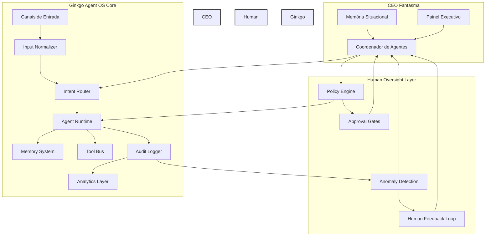

# Ginkgo Source — Manual Técnico Operacional v1.2.0

> **Versão:** 1.2.0 | **Data:** Abril 2026  
> **Status:** Definitivo / Executável  
> **Princípio:** O Ginkgo Source é o sistema onde clientes entram e as soluções nascem, orquestrado pelo CEO Fantasma e governado pela Human Oversight Layer.

---

## 1. Identidade e Visão do Sistema

O **Ginkgo Source** é a plataforma operacional central da Ginkgo AI Systems, projetada para transformar demandas empresariais em soluções operacionais concretas. Ele atua como o **núcleo de conversão entre intenção e execução**, coordenando uma malha de agentes, workflows e sistemas inteligentes para entregar automações, aplicações, sites e operações de IA.

**Função:** Receber demandas, diagnosticar necessidades, projetar soluções, coordenar a execução e garantir a implantação e manutenção de sistemas inteligentes.

**Missão Computacional:** Converter uma intenção humana imperfeita em uma solução estruturada, rastreável, modular e implantável.

**O que o Ginkgo Source entrega:**

| Linha de Produto | Descrição | Exemplos |
|---|---|---|
| **Soluções Prontas** | Pacotes padronizados com implantação rápida. | Atendimento IA, Social Media IA, Gestão/Ops IA, Landing Pages, Dashboards. |
| **Soluções Híbridas** | Base pronta com adaptações por nicho, canal ou processo. | Pacote de Atendimento IA com integração CRM e voz. |
| **Soluções Personalizadas** | Projetos criados sob demanda para necessidades únicas. | Agentes exclusivos, workflows complexos, apps próprios, portais internos. |

---

## 2. Arquitetura Lógica e Princípios Operacionais

O Ginkgo Source opera como um **pipeline de transformação** de demanda, orquestrado pelo **CEO Fantasma** e governado pela **Human Oversight Layer**, seguindo princípios de arquitetura que garantem escalabilidade, auditabilidade e reuso.

**Princípios de Arquitetura:**

1.  **Separação entre Pensar, Decidir e Executar:** O sistema não concentra tudo em um único agente, reduzindo alucinação operacional e aumentando o reuso.
2.  **O Router Não é Executor:** O router central classifica, prioriza, delega e consolida, mas não executa tarefas complexas.
3.  **Toda Tarefa Produz Artefato:** Cada etapa gera uma saída objetiva (briefing, escopo, plano técnico, workflow, layout, etc.).
4.  **Reuso é Prioridade:** O sistema busca reutilizar templates, prompts, blocos lógicos e integrações antes de criar do zero.
5.  **Toda Solução Classificável:** Cada entrega se encaixa em uma taxonomia clara para facilitar automação futura e análise.
6.  **CEO Fantasma como Maestro:** O orquestrador executivo central que transforma contexto em prioridade e prioridade em ação.
7.  **Humano no Loop:** A autonomia da IA é sempre proporcional ao risco da ação e à capacidade de observabilidade, correção e intervenção humana, garantida pela Human Oversight Layer.

---

## 3. Catálogo de Agentes-Base do Ginkgo Source

Cada agente possui uma função única, entradas definidas, ferramentas autorizadas e formato de saída esperado. Para detalhes sobre os contratos de cada agente, incluindo schemas de input/output, ferramentas permitidas e políticas de retry, consulte o documento [AGENT-CONTRACTS.md](AGENT-CONTRACTS.md).

| Agente | Função | Entradas Típicas | Saídas Típicas |
|---|---|---|---|
| **Source Intake** | Normaliza entrada e prepara triagem. | Pedido bruto (texto, formulário, mensagem). | Demanda estruturada. |
| **Source Discovery** | Refina o problema real, reduz ambiguidade. | Demanda estruturada. | Briefing técnico-comercial. |
| **Source Architect** | Desenha a solução macro e define a composição. | Briefing, histórico, ativos reutilizáveis. | Arquitetura proposta, módulos, plano de implementação. |
| **Source Builder Flow** | Constrói lógica operacional e automações. | Especificação de fluxo, blueprint executável. | Workflow funcional, integrações, regras. |
| **Source Builder Interface** | Produz interfaces de uso (front-end). | Arquitetura de interface, estrutura de telas. | Landing pages, dashboards, portais, apps leves. |
| **Source Content** | Cria ativos de comunicação relacionados à solução. | Briefing de comunicação, contexto da solução. | Copy, roteiros, posts, criativos. |
| **Source QA** | Audita consistência, clareza e segurança da solução. | Artefatos de execução, briefing, políticas. | Aprovação/reprovação com ajustes. |
| **Source Success** | Fecha o ciclo operacional, garante continuidade e expansão. | Solução implantada, feedback do cliente. | Plano de continuidade, recomendações de expansão. |

**Contrato Operacional dos Agentes:** Cada agente deve aderir a um contrato explícito que define seu propósito, inputs aceitos, ações proibidas, ferramentas permitidas, schema de output esperado, critérios de sucesso, condições de falha e regras de escalonamento. Detalhes completos em [AGENT-CONTRACTS.md](AGENT-CONTRACTS.md).

---

## 4. Pipeline de Operação e Jornada do Cliente

O Ginkgo Source guia o cliente através de uma jornada estruturada, desde a captação da demanda até a expansão da solução. Para uma visão detalhada dos estados do job e suas transições, consulte o documento [STATE-MACHINE-AUDIT.md](STATE-MACHINE-AUDIT.md).

1.  **Entrada:** Cliente chega via landing page, formulário, WhatsApp, chat, etc.
2.  **Leitura da Demanda:** O sistema identifica tipo de problema, urgência, complexidade e categoria de solução.
3.  **Diagnóstico:** A demanda é convertida em um briefing claro e objetivo.
4.  **Roteamento:** O router central escolhe os agentes especialistas que atuarão na demanda. As políticas de roteamento são detalhadas em [ROUTING-POLICY.md](ROUTING-POLICY.md).
5.  **Produção:** Agentes constroem a proposta, escopo, workflow, interface, conteúdo e documentação.
6.  **Validação:** O Agente QA revisa consistência, clareza e viabilidade da solução.
7.  **Implantação:** A solução é ativada, documentada e entregue ao cliente.
8.  **Expansão:** O cliente recebe melhorias, upgrades e novos módulos, garantindo retenção e upsell.

**Estados do Sistema:** Todo pedido possui estados explícitos (`captured`, `diagnosing`, `in_execution`, `deployed`, etc.) para auditoria, dashboards e automação interna. Veja [STATE-MACHINE-AUDIT.md](STATE-MACHINE-AUDIT.md) para o diagrama completo da máquina de estados e especificação de auditoria.

---

## 5. Stack Conceitual e Ferramentas Chave

Embora o manual seja agnóstico a ferramentas específicas, a lógica operacional sugere a seguinte stack conceitual:

| Camada | Componentes Conceituais | Ferramentas Chave (Exemplos) |
|---|---|---|
| **Orquestração** | CEO Fantasma, Router, fila de tarefas, agentes especializados. | CEO Fantasma (Claude Opus 4.6), OpenClaw, BullMQ, n8n. |
| **Execução** | Runtime de agentes, automações, construtor de interface, geração de conteúdo. | Claude Code, Fastify/Node.js, MoviePy, React/Next.js. |
| **Memória** | Histórico de clientes, projetos, preferências, ativos. | Supabase (Postgres), Redis, Supabase Vector/Qdrant. |
| **Governança** | Human Oversight Layer, Policy Engine, Approval Gates, Anomaly Detection. | Custom (baseado em Supabase, n8n, dashboards). |
| **Entrega** | Dashboard, portal do cliente, documentação, suporte. | Next.js, Chatwoot, Supabase Storage. |

---

## 6. Governança e Metas Operacionais

**Regras de Governança:**

-   **Toda tarefa:** Deve ter objetivo, contexto, limite, saída esperada e status.
-   **Todo agente:** Deve ter função única, entradas definidas, ferramentas permitidas, formato de saída, critérios de falha e escalonamento. Detalhes em [AGENT-CONTRACTS.md](AGENT-CONTRACTS.md).
-   **Toda entrega:** Deve passar por revisão lógica, comercial, técnica e validação final.
-   **Human Oversight Layer:** Garante que a autonomia da IA seja proporcional ao risco da ação. Detalhes em [HUMAN-OVERSIGHT-GOVERNANCE.md](HUMAN-OVERSIGHT-GOVERNANCE.md).

**Metas Operacionais (Estágios de Evolução):**

1.  **Estágio 1 (Agência Assistida por IA):** Você supervisiona a maior parte das operações.
2.  **Estágio 2 (Agência Operada por IA com Revisão Humana):** Agentes executam 70-80% das tarefas, com sua revisão estratégica.
3.  **Estágio 3 (Agência Semi-Autônoma):** Você atua como diretor de estratégia e validação, com alta autonomia dos agentes.

---

## 7. Posicionamento Estratégico

O Ginkgo Source não é apenas uma agência, um SaaS ou um chatbot. É um **sistema operacional de criação e entrega de soluções digitais com IA e automação**.

**Frases-Mãe de Posicionamento:**

-   "Onde sua necessidade vira sistema."
-   "O núcleo onde soluções nascem."
-   "Da demanda à operação."
-   "Entre a ideia e a implantação, existe o Source."
-   "Você pede. O Source estrutura. A Ginkgo entrega."

---

## 8. Arquitetura de Decisão e Governança

Para aprofundar nos mecanismos de decisão e controle do Ginkgo Source, consulte os seguintes documentos:

-   **[ROUTING-POLICY.md](ROUTING-POLICY.md):** Detalha as políticas de roteamento do Agentic Router, incluindo classificação de demanda, regras de complexidade, sequência de agentes, paralelização, bloqueios e escalonamentos.
-   **[AGENT-CONTRACTS.md](AGENT-CONTRACTS.md):** Especifica os contratos tipados para cada agente, definindo schemas de input/output, ferramentas permitidas, condições de falha e políticas de retry.
-   **[STATE-MACHINE-AUDIT.md](STATE-MACHINE-AUDIT.md):** Apresenta a máquina de estados completa para os jobs, transições permitidas, responsabilidades por estado e a especificação do Execution Ledger para auditoria e telemetria.
-   **[HUMAN-OVERSIGHT-GOVERNANCE.md](HUMAN-OVERSIGHT-GOVERNANCE.md):** Formaliza a camada de observabilidade, controle humano e governança por risco, definindo níveis de risco, autonomia da IA e fluxos de intervenção humana.
-   **[CEO-GHOST-SPEC.md](CEO-GHOST-SPEC.md):** Especifica o CEO Fantasma como o orquestrador executivo central, detalhando sua persona, arquitetura em camadas, matriz de autonomia e interfaces de interação.

---

*Ginkgo AI Systems — docs/GINKGO-SOURCE-MANUAL.md v1.2.0 — Abril 2026*
