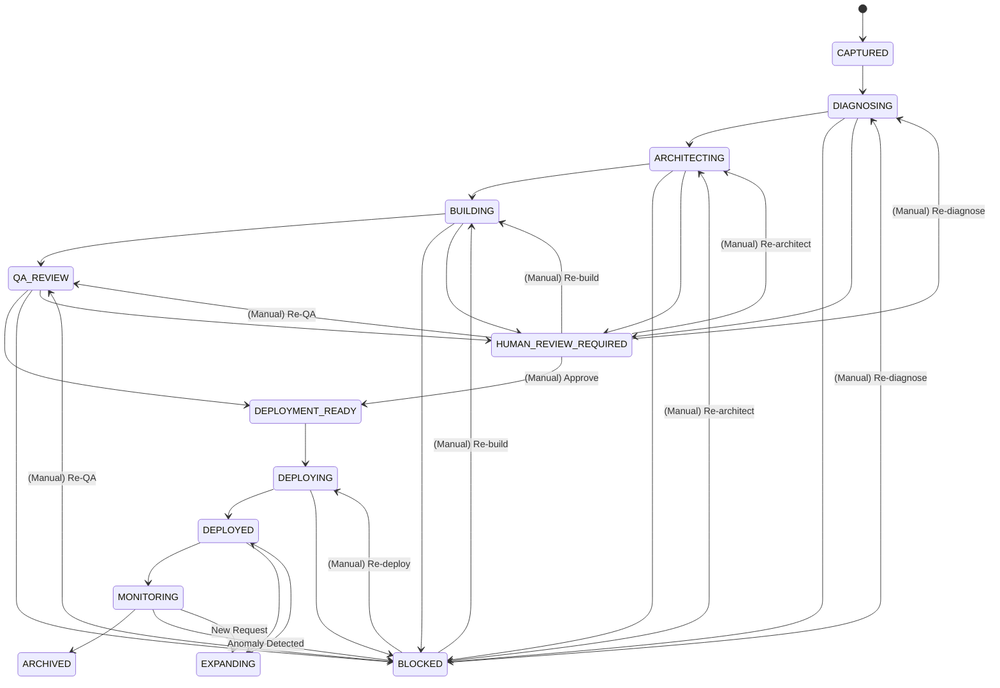

# STATE-MACHINE-AUDIT.md — Ginkgo Source v1.0.0
## Máquina de Estados e Especificação de Auditoria para Jobs

> **Versão:** 1.0.0 | **Data:** Abril 2026  
> **Status:** Definitivo / Executável  
> **Princípio:** Todo job tem um estado claro, transições explícitas e uma trilha de auditoria imutável.

---

## 1. Visão Geral da Máquina de Estados

A Máquina de Estados do Ginkgo Source define o ciclo de vida de cada job (demanda do cliente) dentro da plataforma. Cada transição de estado é governada por regras claras, garantindo previsibilidade, rastreabilidade e a capacidade de intervir ou escalar quando necessário. O objetivo é transformar o fluxo operacional em um processo determinístico e auditável.

**Objetivo:** Fornecer um modelo formal para o ciclo de vida dos jobs, permitindo monitoramento em tempo real, automação de transições e detecção de anomalias.

---

## 2. Estados do Job e Transições Permitidas

Todos os jobs (`request_id`) no Ginkgo Source devem estar em um dos seguintes estados. As transições são unidirecionais, exceto para `blocked` e `human_review_required`.



**Descrição dos Estados:**

| Estado | Descrição | Agente Responsável pela Transição |
|---|---|---|
| `CAPTURED` | Demanda inicial recebida e normalizada. | `Source Intake` |
| `DIAGNOSING` | Demanda em análise para refinar problema e escopo. | `Source Discovery` |
| `ARCHITECTING` | Solução macro sendo desenhada e plano de implementação definido. | `Source Architect` |
| `BUILDING` | Artefatos da solução (workflows, interfaces, conteúdo) sendo construídos. | `Source Builder Flow`, `Source Builder Interface`, `Source Content` |
| `QA_REVIEW` | Solução em fase de auditoria de qualidade e conformidade. | `Source QA` |
| `DEPLOYMENT_READY` | Solução aprovada e pronta para implantação. | `Source QA` |
| `DEPLOYING` | Solução sendo ativada no ambiente do cliente. | `Source Success` |
| `DEPLOYED` | Solução ativa e operacional no ambiente do cliente. | `Source Success` |
| `MONITORING` | Solução em acompanhamento pós-implantação. | `Source Success` / `Monitoring System` |
| `EXPANDING` | Cliente solicitou expansão ou melhoria da solução. | `Source Success` / `Source Intake` |
| `BLOCKED` | Job interrompido devido a falha crítica ou violação de política. Requer intervenção manual. | `Policy Engine` / `Tool Executor` / `Agent Runtime` / `Source QA` |
| `HUMAN_REVIEW_REQUIRED` | Job aguardando aprovação ou decisão humana em ponto crítico. | `Policy Engine` / `Agent` |
| `ARCHIVED` | Job concluído e arquivado. | `Source Success` |

---

## 3. Quem Pode Mover o Estado

As transições de estado são controladas por agentes ou por intervenção humana autorizada.

| Transição | Agente/Entidade Responsável |
|---|---|
| `CAPTURED` → `DIAGNOSING` | `Agentic Router` (após `Source Intake` finalizar) |
| `DIAGNOSING` → `ARCHITECTING` | `Agentic Router` (após `Source Discovery` finalizar) |
| `ARCHITECTING` → `BUILDING` | `Agentic Router` (após `Source Architect` finalizar) |
| `BUILDING` → `QA_REVIEW` | `Agentic Router` (após todos os `Source Builders` finalizarem) |
| `QA_REVIEW` → `DEPLOYMENT_READY` | `Source QA` (se `qa_result` = `approved`) |
| `DEPLOYMENT_READY` → `DEPLOYING` | `Agentic Router` (após aprovação final ou agendamento) |
| `DEPLOYING` → `DEPLOYED` | `Source Success` (após confirmação de ativação) |
| `DEPLOYED` → `MONITORING` | `Source Success` (imediatamente após `DEPLOYED`) |
| `MONITORING` → `EXPANDING` | `Source Intake` (nova demanda do cliente) |
| `MONITORING` → `BLOCKED` | `Monitoring System` (detecção de anomalia) |
| `*` → `BLOCKED` | `Policy Engine` / `Tool Executor` / `Agent Runtime` / `Source QA` |
| `*` → `HUMAN_REVIEW_REQUIRED` | `Policy Engine` / `Agent` |
| `BLOCKED` → `*` | `Product Owner` / `Ops Team` (intervenção manual) |
| `HUMAN_REVIEW_REQUIRED` → `*` | `Product Owner` / `Source Success` (intervenção manual) |

---

## 4. Especificação de Auditoria (Execution Ledger)

Todo evento significativo no ciclo de vida de um job deve ser registrado em um `Execution Ledger` imutável. Este ledger serve como a fonte única da verdade para telemetria, billing, depuração e conformidade.

**Estrutura do `execution_ledger_entry`:**

```json
{
  "entry_id": "uuid",
  "timestamp": "datetime",
  "request_id": "uuid",
  "tenant_id": "uuid",
  "execution_id": "uuid", // ID da execução específica do agente/tool
  "agent_name": "string", // Nome do agente que gerou o evento
  "event_type": "string", // Ex: "state_transition", "tool_call", "llm_call", "error", "human_handoff"
  "old_state": "string",  // Estado anterior do job (se event_type = state_transition)
  "new_state": "string",  // Novo estado do job (se event_type = state_transition)
  "tool_used": "string",  // Nome da tool invocada (se event_type = tool_call)
  "tool_input": "object", // Input da tool (sanitizado para dados sensíveis)
  "tool_output": "object",// Output da tool (sanitizado para dados sensíveis)
  "llm_model": "string",  // Modelo LLM usado (se event_type = llm_call)
  "llm_prompt_tokens": "integer",
  "llm_completion_tokens": "integer",
  "llm_cost_usd": "float",
  "latency_ms": "integer",
  "status": "success|failure",
  "error_message": "string", // Mensagem de erro (se status = failure)
  "output_artifact_id": "uuid", // ID do artefato gerado (se aplicável)
  "metadata": "object" // Metadados adicionais (ex: IP, user-agent, version)
}
```

**Propagação de IDs:**

-   **`request_id`:** ID único da demanda inicial, propagado por todo o ciclo de vida do job.
-   **`tenant_id`:** ID do tenant, essencial para isolamento de contexto e billing.
-   **`execution_id`:** ID único para cada execução de agente ou tool call, permitindo rastrear a árvore de execução.

**Garantia de Imutabilidade:** O `Execution Ledger` deve ser implementado em um banco de dados append-only ou com mecanismos de imutabilidade (ex: blockchain-like, logs criptografados) para garantir a integridade da trilha de auditoria.

---

*Ginkgo AI Systems — docs/STATE-MACHINE-AUDIT.md v1.0.0 — Abril 2026*
