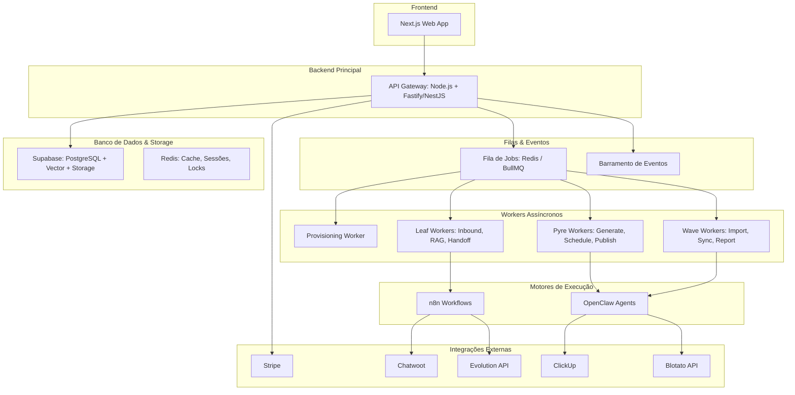

# Guia Definitivo de Construção: SaaS Ginkgo AI Systems

**Autor:** Manus AI
**Versão:** 1.0
**Data:** 06 de Março de 2026

## 1. Visão Estratégica e Arquitetura Unificada

Este documento consolida todas as discussões, arquiteturas e planos de projeto em um guia mestre para a construção da plataforma SaaS **Ginkgo AI Systems**. O objetivo é criar um sistema operacional completo para empresas, focado em automação por IA, com uma arquitetura modular, escalável e multi-tenant desde o primeiro dia.

A plataforma será composta por um núcleo SaaS robusto e módulos de domínio especializados, com uma clara separação entre a API principal (o cérebro do negócio), os workers assíncronos (a força de trabalho) e os motores de execução de agentes (n8n e OpenClaw).

### 1.1. Módulos de Produto

Conforme a documentação, o produto será unificado sob a marca **Leaf by Ginkgo**, mas a arquitetura interna manterá a separação lógica dos agentes para garantir a modularidade.

| Módulo Interno | Agente Responsável | Proposta de Valor | Motor de Execução Primário |
| :--- | :--- | :--- | :--- |
| **Atendimento** | Brann | Atendimento, vendas e suporte conversacional 24/7 em canais de mensageria. | **n8n** |
| **Conteúdo** | Nyra | Criação, agendamento e publicação de conteúdo para redes sociais. | **OpenClaw** |
| **Operações** | Alfred | Planejamento, organização de tarefas e geração de relatórios de campanhas. | **OpenClaw** |

### 1.2. Arquitetura Macro de Serviços

A arquitetura será orientada a eventos e serviços, garantindo que a API principal permaneça leve e responsiva, enquanto tarefas pesadas são delegadas a workers especializados.



## 2. Integração Estratégica: OpenClaw e Blotato

### 2.1. Papel do OpenClaw

O OpenClaw será o motor para os agentes de gestão (Nyra e Alfred), que demandam raciocínio complexo e uso de *skills* dinâmicas. Ele também poderá servir como um canal de chat web dentro da plataforma.

- **Abstração para o Cliente:** O cliente final não configurará o OpenClaw diretamente. A interface do SaaS terá seções para "Configurar Agente de Conteúdo" e "Configurar Agente de Operações", onde o usuário definirá objetivos e personalidades. O backend da Ginkgo traduzirá essas configurações para os arquivos de configuração do agente OpenClaw correspondente ao `tenant_id`.
- **Multi-tenancy:** O OpenClaw pode ser implantado em um modelo de um processo de agente por tenant (maior isolamento, maior custo) ou um pool de workers que processa jobs de uma fila, cada job contendo o `tenant_id` (mais eficiente).

### 2.2. Papel do Blotato

O Blotato será integrado como uma *skill* do OpenClaw, especificamente para o agente Nyra (Conteúdo). Ele servirá como a API unificada para publicação de conteúdo em múltiplas redes sociais (Instagram, Facebook, TikTok, etc.), simplificando o `pyre-publish-worker`.

- **Integração:** O worker de publicação do Pyre, executado pelo OpenClaw, chamará a API do Blotato, passando o conteúdo do post e as credenciais do cliente (armazenadas de forma segura na tabela `integration_secrets`).

## 3. Modelo de Dados Completo (Supabase PostgreSQL)

O schema do banco de dados, conforme detalhado no documento `database-schema.md`, é a fundação do SaaS. Ele é multi-tenant por design, com `tenant_id` em todas as tabelas de negócio e uso de RLS (Row-Level Security) para garantir o isolamento dos dados.

As tabelas estão agrupadas logicamente em:

1.  **Núcleo SaaS:** `tenants`, `profiles`, `memberships`, `module_entitlements`.
2.  **Billing e Uso:** `customers_billing`, `subscriptions`, `invoices`, `credits_ledger`, `usage_events`.
3.  **Integrações:** `integrations`, `integration_secrets`.
4.  **Configuração de Agentes:** `agent_configs`, `onboarding_steps`.
5.  **Módulo Leaf (Atendimento):** `channels`, `contacts`, `conversations`, `messages`, `handoffs`, `kb_documents`, `kb_chunks`.
6.  **Módulo Pyre (Conteúdo):** `brand_kits`, `content_briefs`, `content_assets`, `editorial_calendar`, `publishing_logs`.
7.  **Módulo Wave (Operações):** `clickup_connections`, `wave_workspaces`, `wave_tasks`, `wave_reports`, `sync_jobs`.
8.  **Sistema:** `jobs`, `domain_events`, `audit_logs`.

*(O SQL completo para criação destas tabelas está definido no documento `database-schema.md` e será usado na Fase 1 de implementação).*


## 4. Autenticação e Autorização (Auth)

A segurança e o isolamento de dados são a espinha dorsal do SaaS. A autenticação será gerenciada pela API principal, utilizando um sistema baseado em JWT (JSON Web Tokens).

### 4.1. Fluxo de Autenticação

1.  **Cadastro (Sign-up):** Um novo usuário se cadastra com e-mail e senha. A API cria um registro na tabela `profiles` e, crucialmente, um novo `tenant` e uma `membership` que o vincula como `owner`.
2.  **Login:** O usuário envia e-mail e senha. A API valida as credenciais, gera um JWT contendo `profile_id`, `tenant_id` e `role`, e o retorna ao cliente.
3.  **Requisições Autenticadas:** O frontend anexa o JWT no cabeçalho `Authorization` de todas as requisições subsequentes para a API.
4.  **Validação de Token:** Um middleware na API intercepta cada requisição, valida o JWT e anexa as informações do usuário e do tenant ao objeto da requisição, tornando-os disponíveis para os serviços.

### 4.2. Autorização e Controle de Acesso

- **Isolamento de Tenant (RLS):** O Supabase será configurado com Row-Level Security (RLS) em todas as tabelas sensíveis. As políticas de RLS garantirão que uma query executada em nome de um tenant SÓ possa ler ou escrever dados pertencentes àquele `tenant_id`.
- **Controle de Módulos (Entitlements):** A tabela `module_entitlements` controlará quais módulos (Leaf, Pyre, Wave) estão ativos para cada tenant, com base em sua assinatura. A API verificará esses direitos antes de permitir o acesso a endpoints específicos de cada módulo.
- **Níveis de Acesso (Roles):** A tabela `memberships` definirá a função de um usuário dentro de um tenant (ex: `owner`, `admin`, `member`). Guards na API restringirão ações críticas (como gerenciar billing ou convidar novos membros) apenas para as funções apropriadas.

## 5. Billing e Monetização (Stripe)

A integração com o Stripe será fundamental para a automação do ciclo de vida da assinatura e para a monetização do uso de tokens.

### 5.1. Arquitetura de Billing

- **Stripe como Fonte da Verdade:** O Stripe será a fonte da verdade para o status da assinatura (`active`, `past_due`, `canceled`).
- **Webhooks:** A API terá um endpoint para receber webhooks do Stripe (ex: `customer.subscription.created`, `invoice.payment_succeeded`, `invoice.payment_failed`).
- **Sincronização Local:** As tabelas `customers_billing` e `subscriptions` no Supabase serão um espelho dos dados relevantes do Stripe, atualizadas via webhooks para evitar chamadas constantes à API do Stripe.

### 5.2. Fluxo de Assinatura

1.  **Seleção de Plano:** O usuário seleciona um plano na tela de `pricing`.
2.  **Criação de Checkout Session:** A API cria uma `Stripe Checkout Session` e redireciona o usuário para a página de pagamento do Stripe.
3.  **Pagamento e Webhook:** Após o pagamento, o Stripe envia um webhook `invoice.payment_succeeded` para a API da Ginkgo.
4.  **Provisionamento:** O handler do webhook:
    a.  Atualiza a tabela `subscriptions` para o status `active`.
    b.  Atualiza a tabela `module_entitlements` com os módulos incluídos no plano.
    c.  Adiciona um job `tenant.provision` na fila (BullMQ) para iniciar o provisionamento assíncrono da infraestrutura operacional do cliente.

### 5.3. Monetização de Tokens (Uso do OpenClaw)

O uso dos agentes OpenClaw (Nyra e Alfred) será metrificado e cobrado separadamente da assinatura base, criando uma fonte de receita variável.

- **Medição (Metering):** O `usage-worker` registrará eventos de uso (ex: `pyre.content.generated`, `wave.plan.generated`) na tabela `usage_events`.
- **Agregação:** Um job recorrente (`usage.flush`) consolidará esses eventos e atualizará o `credits_ledger` do tenant.
- **Cobrança (Stripe Metered Billing):** Periodicamente (ex: no final do mês), um job chamará a API do Stripe para reportar o uso agregado para o item de preço medido (`metered price item`), que será adicionado à próxima fatura do cliente.
- **Margem de Lucro:** O preço por token/evento cobrado do cliente terá uma margem de lucro sobre o custo real dos provedores de LLM (OpenAI, Anthropic, etc.).


## 6. Telas e Experiência do Usuário (UI/UX)

A interface do usuário deve ser intuitiva, limpa e funcional, refletindo a sofisticação da tecnologia subjacente. A estrutura de navegação principal será composta por um menu lateral que dá acesso aos módulos principais e às configurações.

### 6.1. Telas Principais

| Tela | Propósito | Componentes Chave | Inspiração Visual |
| :--- | :--- | :--- | :--- |
| **Dashboard Principal** | Visão geral do status da automação, consumo e alertas. | - Status dos módulos (Leaf, Pyre, Wave)<br>- Consumo de tokens/créditos<br>- Status das integrações<br>- Alertas e notificações<br>- Atalhos para ações comuns | Metabase / Grafana |
| **Wizard de Onboarding** | Guiar o novo usuário na configuração inicial da conta. | - Passos guiados (Conectar Canal, Configurar Agente, etc.)<br>- Barra de progresso<br>- Quality Gate para validar a configuração | Intercom / Typeform |
| **Página Leaf (Atendimento)** | Gerenciar conversas, canais e contatos. | - **Sidebar de Canais:** Lista de canais conectados (WhatsApp, IG).<br>- **Inbox de Conversas:** Lista de conversas ativas, pendentes e fechadas.<br>- **Painel da Conversa:** Histórico de mensagens (sincronizado com Chatwoot).<br>- **Painel do Agente:** Informações do contato (do CRM), notas internas, status do handoff. | Chatwoot / Intercom |
| **Página Pyre (Conteúdo)** | Criar, aprovar e agendar conteúdo para redes sociais. | - **Editor de Brief:** Formulário para definir objetivos da campanha.<br>- **Canvas de Conteúdo:** Área para visualizar e editar os ativos gerados (texto, imagens).<br>- **Painel de Ativos:** Biblioteca de mídias e brand kit.<br>- **Calendário Editorial:** Visão de posts agendados e publicados.<br>- **Chat da Nyra:** Interface para interagir com o agente de conteúdo. | Lovart / Canva |
| **Página Wave (Operações)** | Gerenciar projetos, tarefas e campanhas. | - **Dashboard de Campanhas:** Visão geral de projetos em andamento.<br>- **Kanban de Tarefas:** Colunas de status para tarefas (sincronizado com ClickUp).<br>- **Chat do Alfred:** Interface para interagir com o agente de operações.<br>- **Painel de Relatórios:** Visualização de performance e KPIs. | ClickUp / Asana |
| **Página de Billing** | Gerenciar assinaturas, faturas e consumo. | - Plano atual e opções de upgrade/downgrade.<br>- Histórico de faturas.<br>- Detalhamento do consumo de tokens/créditos. | UI da Vercel / DigitalOcean |
| **Página de Configurações** | Gerenciar aspectos da conta e integrações. | - **Meu Perfil:** Dados do usuário.<br>- **Membros da Equipe:** Convidar e gerenciar usuários.<br>- **Integrações:** Conectar e gerenciar APIs (Evolution, ClickUp, Blotato, etc.).<br>- **Configurações do Tenant:** Nome da empresa, etc. | UI do GitHub / Stripe |

## 7. Roadmap de Implementação por Épicos

A implementação seguirá a ordem de épicos e stories detalhada no documento `aios-ready-plan.md`, garantindo que o valor seja entregue de forma incremental e que as fundações sejam construídas primeiro.

1.  **Épico 1: Core SaaS Foundation:** Construir a base de autenticação, multi-tenancy e billing. **Sem isso, não há SaaS.**
2.  **Épico 2: Provisioning & Onboarding:** Automatizar a criação da infraestrutura do cliente no momento da assinatura.
3.  **Épico 3: Leaf MVP:** Lançar o produto mínimo viável de atendimento conversacional, a principal isca para o mercado imobiliário.
4.  **Épico 6: Marketing Site & Checkout:** Colocar o site no ar e permitir que os clientes assinem e paguem de forma autônoma.
5.  **Épico 4: Pyre MVP:** Introduzir o módulo de geração de conteúdo.
6.  **Épico 5: Wave MVP:** Introduzir o módulo de gestão de operações.
7.  **Épico 7: Observability & Operations:** Implementar monitoramento, logs e alertas para garantir a estabilidade da plataforma em escala.

Este roadmap prioriza a geração de receita e a validação do produto principal (Leaf) o mais rápido possível, antes de expandir para os demais módulos.

## 8. Aprofundamento Técnico: Implementação e Estratégia

Esta seção detalha as lacunas e as estratégias de implementação para os componentes mais inovadores da arquitetura: OpenClaw, n8n, e o sistema autônomo de CRM e RAG.

### 8.1. Implementação do OpenClaw como Motor de Agentes

O OpenClaw não será exposto diretamente ao usuário final. Ele é um motor de execução interno, orquestrado pela API da Ginkgo. A plataforma Ginkgo atuará como um "gerenciador de frotas" para os agentes OpenClaw.

**Arquitetura de Provisionamento:**

1.  **Solicitação de Provisionamento:** Quando um tenant assina um plano que inclui os módulos Pyre ou Wave, a API da Ginkgo adiciona um job `agent.provision` na fila.
2.  **Worker de Provisionamento de Agente:** Um worker especializado consome este job. Ele é responsável por:
    a.  Criar um novo conjunto de configurações de agente (personalidade, objetivos, skills permitidas) e salvá-lo na tabela `agent_configs` associado ao `tenant_id`.
    b.  Se estiver usando um modelo de implantação por tenant (ex: Docker container por tenant), o worker usará a API do provedor de nuvem (ex: AWS Fargate, Railway) para iniciar uma nova instância do OpenClaw, injetando as variáveis de ambiente necessárias (`TENANT_ID`, `AGENT_CONFIG_ID`, `API_KEY_GINKGO`).
    c.  Se estiver usando um modelo de pool de workers, o worker simplesmente garante que a configuração do agente esteja pronta para ser carregada quando um job para aquele tenant for processado.

**Fluxo de Execução de um Job (Ex: Gerar Conteúdo - Pyre):**

1.  **Usuário no App:** O usuário clica em "Gerar Posts" na página Pyre.
2.  **API da Ginkgo:** O frontend envia a requisição para a API principal. A API valida a permissão, cria um job `pyre.generate` com o `tenant_id` e o `brief_id`, e o coloca na fila.
3.  **Worker do OpenClaw:** Um worker do OpenClaw (que pode ser um processo genérico em um pool) pega o job da fila.
4.  **Carregamento de Contexto:** O worker usa o `tenant_id` para carregar a configuração específica do agente (personalidade da Nyra daquele cliente), as `skills` permitidas (como a `blotato-post-skill`) e as credenciais necessárias (da tabela `integration_secrets`).
5.  **Execução do Agente:** O worker instancia o agente OpenClaw em memória com o contexto carregado e passa o prompt do job (ex: "Crie 3 posts para Instagram com base no brief #123").
6.  **Execução da Skill:** O agente OpenClaw executa a tarefa, possivelmente chamando a `blotato-post-skill` para publicar o conteúdo.
7.  **Registro de Uso e Resultado:** Ao final, o worker registra o consumo de tokens na tabela `usage_events` e atualiza o status do job/asset no banco de dados.

**Facilitando a Configuração para o Cliente:**

A tela de "Configuração do Agente" no SaaS não terá termos técnicos como "OpenClaw". Ela terá campos como:
- "Qual é o tom de voz da sua marca? (Ex: Formal, Divertido, Técnico)"
- "Quais são seus principais objetivos de conteúdo? (Ex: Educar, Vender, Engajar)"
- "Conecte suas redes sociais (Blotato)"

O backend da Ginkgo traduzirá essas respostas em um *system prompt* e uma lista de *skills* ativas para o agente daquele tenant.


### 8.2. Arquitetura de Workflows n8n

O n8n atuará como o motor de orquestração para o módulo **Leaf (Atendimento)**, que é mais linear e baseado em integrações diretas com canais de mensageria. A base para esta arquitetura já foi validada nos workflows "Brann" e "Callima".

**Princípios Chave:**

-   **Orquestração, não Lógica de Negócio:** O n8n recebe webhooks, normaliza dados, chama APIs externas (Evolution, Chatwoot) e invoca o agente (Brann), mas não detém o estado do negócio (que reside no Supabase e é gerenciado pela API principal).
-   **Multi-tenancy via Credenciais e Parâmetros:** Cada chamada a um workflow n8n deve incluir o `tenant_id`. O workflow usará esse ID para buscar as credenciais e configurações específicas daquele tenant (ex: API key da Evolution API daquele cliente) antes de executar as ações.
-   **Subworkflows Reutilizáveis:** Lógicas comuns como "enviar mensagem via Evolution", "transcrever áudio" ou "sincronizar com Chatwoot" serão encapsuladas em subworkflows para evitar duplicação e facilitar a manutenção.

**Workflow Principal: `leaf-inbound.json`**

Este é o coração do módulo Leaf e seguirá o fluxo já projetado:

1.  **Webhook Trigger:** Recebe a mensagem de um canal (ex: Evolution API para WhatsApp).
2.  **Normalização:** Extrai e padroniza os dados essenciais: `sender_id`, `message_content`, `media_url`, etc.
3.  **Resolução de Tenant:** Usa o `instance_name` ou outro identificador do webhook para buscar o `tenant_id` correspondente no Supabase.
4.  **Upsert de Entidades:** Cria ou atualiza o `contact` e a `conversation` no banco de dados.
5.  **Pré-processamento de Mídia:** Se a mensagem contém áudio, imagem ou documento, chama subworkflows para transcrição (Whisper), descrição (GPT-4 Vision) ou extração de texto.
6.  **Chamada ao Agente (Brann):**
    a.  Constrói o contexto: busca o histórico recente da conversa (Redis), o perfil do lead (CRM/Supabase) e faz uma busca RAG na base de conhecimento.
    b.  Chama o LLM (GPT-4, Claude) com o *system prompt* de vendas, o contexto montado e a nova mensagem.
7.  **Pós-processamento da Resposta:**
    a.  Recebe a resposta do agente.
    b.  **Decisão de Handoff:** Se o agente decidir transferir para um humano, aciona o workflow `leaf-handoff.json`.
    c.  **Humanização:** Aplica as técnicas de quebra de mensagem e delay de digitação.
    d.  **Decisão de Áudio:** Decide se a resposta deve ser enviada como texto ou áudio (ElevenLabs).
8.  **Envio da Resposta:** Chama o subworkflow de envio para o canal apropriado (ex: Evolution API).
9.  **Sincronização e Logging:** Salva a troca de mensagens no Supabase, sincroniza com o Chatwoot e registra o evento de uso.

### 8.3. Sistema Autônomo de RAG e CRM (Alimentado por Manus)

Esta é uma das inovações centrais da plataforma. Em vez de um RAG estático, o sistema aprende com cada interação, e o CRM é enriquecido dinamicamente. O Manus atua como o cérebro analítico assíncrono.

**Fluxo de Enriquecimento:**

1.  **Trigger:** Ao final de uma conversa ou em um ponto de verificação (checkpoint), o workflow do n8n ou um worker do backend agrupa o contexto da conversa (mensagens do lead, respostas do agente, perfil atual do lead).
2.  **Chamada ao Manus:** O worker envia este pacote de contexto para um endpoint dedicado na API do Manus, com o prompt: "Analise esta interação. Extraia e atualize as informações do CRM e identifique novos conhecimentos para o RAG."
3.  **Análise pelo Manus:** O Manus executa um processo interno para:
    a.  **Análise de Entidades e Fatos:** Identifica informações explícitas e implícitas sobre o lead (ex: "mencionou que tem 3 corretores", "o maior problema é a perda de tempo", "aniversário é em junho").
    b.  **Atualização do CRM:** Formata essas informações em uma estrutura de dados e chama a API da Ginkgo para fazer um `UPSERT` na tabela `contacts` e tabelas relacionadas (ex: `contact_attributes`, `reminders`).
    c.  **Identificação de Conhecimento (RAG):** Isola perguntas do lead que não foram bem respondidas pelo RAG atual ou objeções que surgiram. Ele avalia se essa informação representa um novo conhecimento valioso e universal.
    d.  **Enriquecimento do RAG:** Se um novo conhecimento é identificado, o Manus gera um par de pergunta/resposta canônico, o vetoriza e o insere na tabela `kb_chunks` do Supabase, tornando-o disponível para futuras conversas.

**Vantagens desta Arquitetura:**

-   **Desacoplamento:** O fluxo de conversação em tempo real (n8n) não é bloqueado pela análise, que é mais pesada e pode levar alguns segundos.
-   **Inteligência Centralizada:** O Manus se torna o cérebro de curadoria, permitindo que a lógica de enriquecimento seja aprimorada em um só lugar, sem alterar os múltiplos workflows de conversação.
-   **Efeito de Rede:** Cada conversa de cada cliente melhora a base de conhecimento geral (se aplicável e anonimizado) ou a base específica do tenant, tornando o sistema mais inteligente com o uso. 


### 8.4. Análise de Lacunas e Próximos Passos

A arquitetura e os planos fornecidos são excepcionalmente completos. As lacunas não estão na visão, mas sim nos detalhes de implementação e nas decisões de engenharia que precisarão ser tomadas.

**Lacunas Identificadas:**

1.  **Estratégia de Deploy de Banco de Dados por Tenant:** A arquitetura é multi-tenant em um único banco de dados com RLS. Para clientes enterprise, pode ser necessário oferecer uma opção de banco de dados isolado. A automação para provisionar um novo Supabase (ou similar) por tenant precisa ser projetada.
2.  **Gerenciamento de Segredos por Tenant:** A tabela `integration_secrets` é um ponto crítico de segurança. A estratégia de criptografia para os segredos em repouso (at-rest) e o mecanismo de rotação de chaves precisam ser detalhados.
3.  **Interface de Criação de Skills do OpenClaw:** A ideia de facilitar a criação de agentes é poderosa. No entanto, a interface (UI) para que um usuário não-técnico possa criar ou configurar uma *skill* para o OpenClaw é um desafio de UX/UI complexo e precisará de um épico próprio no futuro.
4.  **Observabilidade e Monitoramento:** Os documentos mencionam a necessidade de logs e healthchecks, mas a stack específica (ex: OpenTelemetry, Grafana, Prometheus, Sentry) e a implementação detalhada dos dashboards de monitoramento ainda precisam ser definidas.

**Próximos Passos Imediatos (Conforme Roadmap):**

O foco absoluto deve ser no **Épico 1: Core SaaS Foundation**. Nada mais importa até que um usuário possa se cadastrar, fazer login, ter um tenant criado e ser identificado corretamente pela API. A implementação deve seguir as *stories* já definidas no documento `aios-ready-plan.md`.

1.  **Setup do Monorepo:** Criar a estrutura de pastas e arquivos conforme o `repository-blueprint.md`.
2.  **Schema do Banco:** Executar o SQL do `database-schema.md` no Supabase.
3.  **Implementação do Módulo de Auth:** Desenvolver os endpoints de `signup`, `login` e o middleware de validação de JWT na API principal.
4.  **Implementação do Módulo de Tenants e Memberships:** Garantir que o cadastro crie as entidades corretas e que as requisições sejam corretamente escopadas pelo `tenant_id`.

## 9. Mapeamento Completo de Canais por Motor de Execução

A distribuição de canais entre os motores de execução é uma decisão arquitetural central. O WhatsApp, por ser o canal principal de vendas e atendimento, será operado pelo n8n (workflow Brann). Os demais canais serão operados pelo OpenClaw, que já possui integrações nativas com dezenas de plataformas de chat.

| Canal | Motor de Execução | Agente | Justificativa |
| :--- | :--- | :--- | :--- |
| **WhatsApp** | n8n (via Evolution API) | Brann | Canal principal de vendas. Requer controle fino de humanização, delays e áudio. O workflow já está validado. |
| **Telegram** | OpenClaw (nativo) | Brann / Alfred | Canal secundário de atendimento e gestão interna. OpenClaw tem integração nativa. |
| **Instagram DM** | OpenClaw (nativo) | Brann / Nyra | Atendimento e engajamento de conteúdo. |
| **Facebook Messenger** | OpenClaw (nativo) | Brann | Atendimento via página da imobiliária. |
| **WebChat (Plataforma)** | OpenClaw (WebChat UI) | Todos | Chat embutido na plataforma SaaS para interagir com qualquer agente. |
| **Slack / Discord** | OpenClaw (nativo) | Alfred | Comunicação interna de equipes e notificações. |

## 10. Estrutura do Repositório (Monorepo)

A estrutura do repositório segue o padrão definido no `repository-blueprint.md`, organizado como um monorepo com separação clara entre aplicações, workers, pacotes compartilhados e infraestrutura.

```
ginkgo-plataform/
├─ apps/
│  ├─ web/                     # Frontend SaaS (Next.js)
│  │  ├─ app/
│  │  │  ├─ login/
│  │  │  ├─ dashboard/
│  │  │  ├─ onboarding/
│  │  │  ├─ leaf/
│  │  │  ├─ pyre/
│  │  │  ├─ wave/
│  │  │  └─ billing/
│  │  ├─ components/
│  │  ├─ lib/
│  │  └─ styles/
│  │
│  └─ api/                     # Backend principal (Node + Fastify)
│     ├─ src/
│     │  ├─ modules/
│     │  │  ├─ auth/
│     │  │  ├─ tenants/
│     │  │  ├─ billing/
│     │  │  ├─ usage/
│     │  │  ├─ integrations/
│     │  │  ├─ leaf/
│     │  │  ├─ pyre/
│     │  │  └─ wave/
│     │  ├─ common/
│     │  │  ├─ db/
│     │  │  ├─ guards/
│     │  │  └─ middleware/
│     │  └─ config/
│     └─ package.json
│
├─ workers/
│  ├─ provisioning/
│  ├─ leaf/
│  │  ├─ inbound/
│  │  ├─ rag/
│  │  └─ handoff/
│  ├─ pyre/
│  │  ├─ generate/
│  │  ├─ schedule/
│  │  └─ publish/
│  ├─ wave/
│  │  ├─ import/
│  │  ├─ sync/
│  │  └─ report/
│  └─ usage/
│
├─ packages/
│  ├─ shared/
│  ├─ db/
│  ├─ queue/
│  ├─ events/
│  └─ auth/
│
├─ infra/
│  ├─ docker/
│  │  └─ docker-compose.yml
│  ├─ n8n/
│  │  └─ workflows/
│  └─ scripts/
│
├─ docs/
│  ├─ prd/
│  ├─ architecture/
│  ├─ epics/
│  └─ stories/
│
└─ README.md
```

## 11. Conclusão e Próximos Passos

Este guia representa o plano de batalha completo e definitivo para a construção do SaaS Ginkgo AI Systems. Ele unifica a visão de produto com uma arquitetura técnica robusta, um modelo de dados detalhado, estratégias claras de monetização e um plano de implementação faseado.

A execução disciplinada deste plano, seguindo a ordem dos épicos e as definições de "pronto" (Definition of Done) para cada story, resultará na criação de uma plataforma SaaS poderosa, escalável e pronta para dominar o nicho imobiliário.

O próximo passo concreto é iniciar o **Épico 1: Core SaaS Foundation**, criando o monorepo, executando o schema SQL no Supabase e implementando os módulos de autenticação e tenancy.

---

### Referências

*Os documentos de arquitetura, schemas e planos de projeto fornecidos pelo Gabriel foram a base para a criação deste guia consolidado. As informações sobre o OpenClaw foram obtidas do repositório oficial em [github.com/openclaw/openclaw](https://github.com/openclaw/openclaw) e as informações sobre o Blotato da documentação em [blotato.com](https://www.blotato.com/).*
